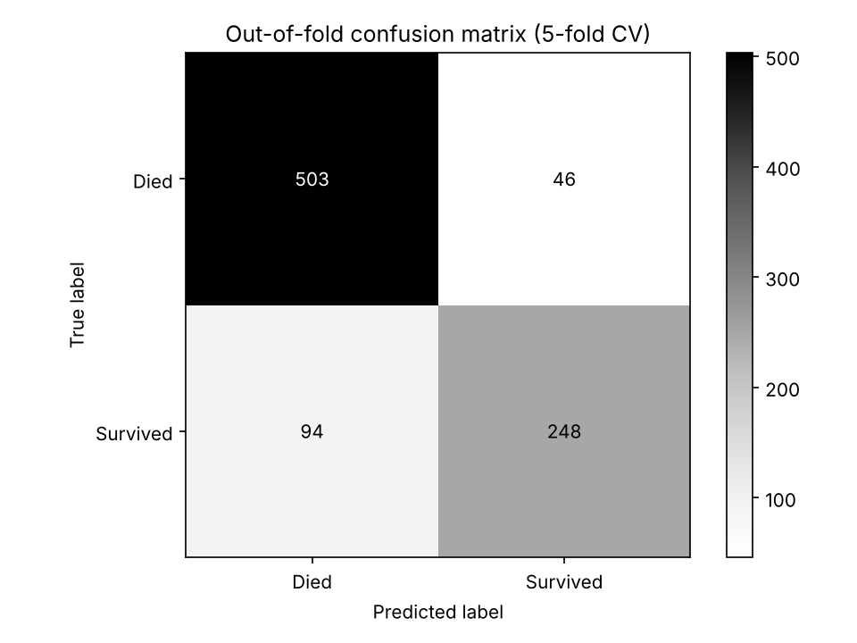

# Titanic Survival Prediction


Predicts which Titanic passengers survived from their ticket and personal details, using a leakage-safe scikit-learn pipeline evaluated with stratified cross-validation.



## Problem and approach

The [Kaggle Titanic dataset](https://www.kaggle.com/competitions/titanic) is small (891 labelled passengers) and messy: Age is missing for 20% of passengers, Cabin for 77%, and the test set has a missing Fare that never appears in training.

The project focuses on handling that data correctly rather than on chasing a leaderboard score:

- **Leakage-safe preprocessing:** imputation, scaling, one-hot encoding and feature engineering all run inside a single scikit-learn `Pipeline`, so nothing is learned from validation data.
- **Honest validation:** every decision is made with 5-fold stratified cross-validation and compared against simple baselines.
- **Evidence-based features:** each engineered feature was tested in an ablation study and kept only if it improved the score.

## Model

The submitted model is a **woman-child-group** rule. Families and groups on the same ticket tended to live or die together, so:

```
start from: women survive, men do not
  -> a woman whose travel group's women and boys all died   -> predicted to die
  -> a boy (Master) whose group's women and boys all lived  -> predicted to survive
```

Groups are matched by ticket number, and by surname + class + ticket prefix, which links test passengers to relatives in the training set. Adult men are left out of the group statistics because almost all of them died whatever their group did. The group rates are learned only from the training folds, so cross-validation stays leakage-free.

The gradient boosting pipeline is kept for comparison in `titanic-experiments`:

```
raw passenger data
  -> add_features        Title extracted from Name
  -> ColumnTransformer
       numeric      Age, Fare, SibSp, Parch  -> median imputation -> scaling
       categorical  Sex, Pclass, Embarked, Title -> most-frequent imputation -> one-hot encoding
  -> GradientBoostingClassifier
```

## Results

All cross-validation (CV) scores are accuracy on 5 stratified folds of the 891 training passengers (mean ± standard deviation).

| Approach | CV accuracy |
|---|---|
| Baseline: everyone died | 0.616 |
| Baseline: women survive, men do not | 0.787 |
| Logistic regression, raw columns | 0.797 ± 0.015 |
| Gradient boosting, raw columns | 0.827 ± 0.020 |
| Gradient boosting, raw columns + Title | 0.839 ± 0.011 |
| Gradient boosting, raw + Title, tuned | 0.845 ± 0.010 |
| **Woman-child-group rule** | **0.843 ± 0.018** |

On 10 × 5-fold repeated CV the woman-child-group rule scores 0.841 ± 0.025. The CV score is about the same as the tuned gradient boosting model, but the rule has no tuned parameters and fits only two exceptions to the women-survive baseline, so its CV score is much less optimistic. Public Kaggle notebooks that use the same rule report about 0.818 on the public leaderboard.

**Feature ablation (gradient boosting):** adding Title gave the largest and most stable gain (+0.012, with the spread halved). FamilySize, IsAlone and HasCabin added nothing on top of Title, so they were left out.

**Out-of-fold metrics for the final model:**

| Class | Precision | Recall | F1 |
|---|---|---|---|
| Died | 0.843 | 0.916 | 0.878 |
| Survived | 0.844 | 0.725 | 0.780 |

**Kaggle public leaderboard:** the previous gradient boosting model scored 0.761 (159 of 209 passengers), against 0.766 (160 of 209) for Kaggle's women-survive example submission. The woman-child-group submission changes 17 of the 418 test predictions from that example submission (9 women predicted to die, 8 boys predicted to survive). Its leaderboard score has not been recorded yet.

## Limitations

- **CV overestimates real performance.** The CV scores are optimistic, because the features, model and parameters were all chosen by comparing CV scores on the same 891 passengers. The leaderboard score is the independent check.
- **Perfect scores at the top of the leaderboard are not reachable honestly.** The true outcome of every passenger is public, so the top of the Titanic leaderboard is crowded with 1.0 submissions copied from those records. Honest models usually score between 0.78 and 0.82.
- **The public leaderboard is noisy.** It scores only 209 passengers, so each passenger is worth about 0.5 percentage points. The final model and the women-survive baseline differ by one passenger there, which is within noise.
- **The model misses about a quarter of survivors** (recall 0.740). It leans towards predicting "died", the majority class, and struggles most with the less typical survivors, such as men who survived and women in third class who survived.

## Getting started

### Prerequisites

- Python 3.10 or later
- A Kaggle account that has joined the Titanic competition, with an API token saved to `~/.kaggle/access_token`

### Installation

```bash
git clone https://github.com/Ohm-Kel/titanic-survival.git
cd titanic-survival
python -m venv .venv
.venv\Scripts\Activate.ps1      # Windows
# source .venv/bin/activate     # macOS/Linux
pip install -r requirements.txt
pip install -e ".[dev]"
python scripts/download_data.py
```

### Usage

```bash
titanic-experiments   # feature ablation and model comparison
titanic-train         # evaluate and save models/model.joblib
titanic-predict       # write data/submissions/submission.csv
```

### Running tests

```bash
pytest -v --cov=titanic --cov-report=term-missing
```

The tests use a small hand-written fixture (`tests/fixtures/train.csv`), so they need neither the Kaggle data nor an API token.

## Project structure

```
src/titanic/
  data.py           load train.csv and test.csv
  features.py       Title, FamilySize, IsAlone, HasCabin
  pipeline.py       feature engineering, preprocessing and model
  groups.py         woman-child-group model (submitted)
  experiments.py    feature ablation and model comparison
  train.py          evaluation and model saving
  predict.py        Kaggle submission file
notebooks/01_eda.ipynb   exploratory data analysis
scripts/download_data.py Kaggle API download
tests/                   pytest suite and fixture
reports/figures/         generated evaluation charts
```

Kaggle data, trained models and submissions are git-ignored.

## Roadmap

- Probability calibration and decision-threshold tuning to improve recall on survivors

## Tech stack

Python, pandas, scikit-learn, matplotlib, Jupyter, pytest, Ruff, GitHub Actions

## License

MIT